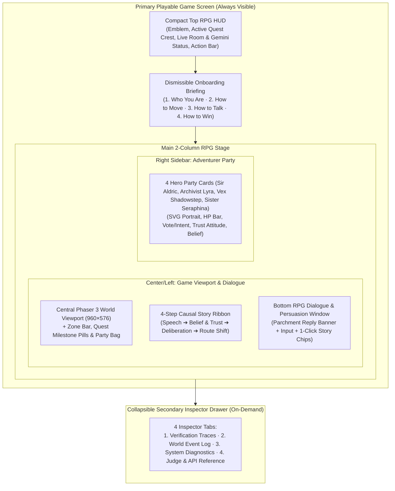

# UI/UX Design & Information Architecture — Guardian Tales-Inspired RPG Shell

## Design Philosophy

**Administration of the Video Game (전자오락관리국)** is an interactive top-down fantasy RPG where human players inhabit ordinary village NPCs (`Mira the Herbalist`, `Clerk Hana`, `Watchman Jin`, etc.) and reshape an autonomous 4-hero AI party's quest through natural-language persuasion.

To ensure the prototype feels like an authentic, playable video game rather than an engineering telemetry dashboard, the UI/UX is built around a **Guardian Tales-inspired modern retro RPG shell**:
- **Vibrant Fantasy Aesthetic**: Rich royal-blue and slate frames accented with beveled gold trim (`#f5c451`), warm parchment dialogue boxes (`#fdf5e1` / `#f5e4bc`), and tactile 3D arcade buttons.
- **Canvas-First Hierarchy**: The Phaser 3 tilemap viewport (`960×576`, `30×18` grid) occupies the visual center of the screen so player movement, hero formations, speech bubbles, and physical pathfinding remain the star of the presentation.
- **Visible Causal Chain**: A 4-step story ribbon directly beneath the viewport connects **Villager Speech ➔ Hero Belief & Trust ➔ Party Deliberation ➔ Visible Route Change** in plain RPG language.
- **Zero-Clutter Telemetry**: Deep agent verification traces, raw event logs, and system diagnostics are housed in a **Collapsible 4-Tab Secondary Drawer** at the bottom of the screen—accessible in one click for judges without overwhelming gameplay.

---

## Layout Structure & Panel Hierarchy

### 1. Primary Panels (Always Visible During Gameplay)

| Panel | DOM Selector | Purpose & Key Affordances |
| :--- | :--- | :--- |
| **Compact Top RPG HUD** | `header.rpg-top-hud` | Displays game emblem, active quest destination crest (`#quest-goal-badge`, `#route-indicator`), multiplayer room status (`#players-label`), Gemini model pill (`#hud-ai-badge`), and tactile 3D RPG buttons (`❓ Guide`, `📍 Approach Party`, `⏩ +5 Steps`, `⏸️ Pause Walk`, `🔄 Reset`, `🔍 Traces`). |
| **Onboarding Field Briefing** | `section#onboarding-banner` | Explains the 4 essentials for first-time players and judges: **Who You Are**, **How to Move**, **How to Talk**, and **What Success Looks Like**. Can be dismissed (`Got It — Start Playing!`) or reopened anytime via `❓ Guide`. |
| **Central Game Viewport** | `.rpg-viewport-frame` | Houses the `960×576` Phaser 3 canvas (`#phaser-container`), flanked by a top zone/landmark bar (`Oakhaven Village`, `Whispering Marsh`, `Ancient Cave`) and quest milestone pills (`Storehouse Verified`, `Sacred Ward`, `Marsh Lie Disproven`, `Cave Entered`, `Ancient Seal`), plus a bottom keyboard legend and live Party Bag (`#inventory-row`). |
| **4-Step Causal Story Ribbon** | `.causal-story-ribbon` | Highlights the active causal chain in real time: `STEP 1 Villager Speech` (`#causal-input`) ➔ `STEP 2 Hero Belief & Trust` (`#causal-belief`) ➔ `STEP 3 Party Deliberation` (`#causal-deliberation`) ➔ `STEP 4 Visible Route Change` (`#causal-action`). |
| **Bottom RPG Dialogue Window** | `.rpg-dialogue-window` | Features a **warm parchment Conversation Feedback Banner** (`#latest-dialogue-banner`) showing the latest hero portrait, role badge, and in-character response quote; a villager identity bar (`Your NPC`, `Speak To` selector `#target-agent-select`); natural-language dialogue input; and **4 one-click Story Choice chips** (`#chip-storehouse`, `#chip-marsh`, `#chip-injection`, `#chip-cave`). |
| **Right-Side Party Panel** | `aside.party-sidebar` | Displays the 4 autonomous heroes (**Sir Aldric**, **Archivist Lyra**, **Vex Shadowstep**, **Sister Seraphina**) as tactile RPG character cards (`#agents-grid .agent-card`). Each card shows an original pixel-art SVG portrait, level badge, visual HP progress bar, current vote/intent badge, friendly attitude/trust status (`★ Trusted Ally`, `😊 Receptive`, `😐 Neutral`, `🤨 Skeptical`, `⚠️ Distrusted`), and verified memory/belief summary. Clicking any hero card targets that hero for dialogue. |

### 2. Secondary Panels (Collapsible 4-Tab Inspector Drawer)

To keep the primary screen focused on gameplay while still giving hackathon judges full visibility into the underlying multi-agent architecture, `section#secondary-drawer` provides four switchable tabs:

1. **🔍 Verification Traces (`#tab-traces`)**: Shows the latest structured `Observe ➔ Reason (gemini-4-argon) ➔ Propose JSON ➔ Validate ➔ Execute ➔ Memory Verification` cards (`#trace-list`) and whether each turn was powered by live Gemini (`gemini-4-argon`) or deterministic fallback.
2. **📜 World Event Log (`#tab-events`)**: Chronological stream of movement, dialogue, item pickup, combat resolution, and quest flag transitions (`#event-list`).
3. **⚙️ System Diagnostics (`#tab-diag`)**: Live Gemini model ID (`gemini-4-argon`), thinking configuration (`ThinkingLevel.HIGH`), call counter (`AI Calls: X/60`), and authoritative security gate status (`#diag-grid`).
4. **🧪 Judge & API Reference (`#tab-dev`)**: Repeatable verification loop explanation and `curl` commands for `/api/diagnostics` and `/api/traces`.

---

## Visual & Interactive Enhancements Over Initial MVP

1. **From Engineering Dashboard to Playable Fantasy RPG**: Replaced the dark 3-column monitoring layout with a bright, high-contrast royal-blue, gold, and warm-parchment RPG interface inspired by *Guardian Tales*.
2. **Immediate Onboarding Clarity**: New visitors immediately understand their role as a controllable villager NPC, how to move (`WASD` / click), how to persuade heroes, and what visual change proves success.
3. **Custom Pixel-Art SVG Hero Portraits & Attitude Badges**: Each hero now has an unmistakable visual silhouette, color-coded class badge, visual HP bar, and human-readable trust attitude (`★ Trusted Ally` to `⚠️ Distrusted`).
4. **Parchment Conversation Feedback Banner**: Whenever a hero responds to a villager, their portrait and spoken reply appear prominently in the warm parchment dialogue box at the bottom of the screen as well as in an above-head canvas speech bubble (`#fef9e7` with gold border).
5. **Click-to-Target Hero Selection**: Clicking a hero either on the Phaser canvas or in the Right-Side Party Panel highlights their card and sets them as the active dialogue recipient (`#target-agent-select`).
